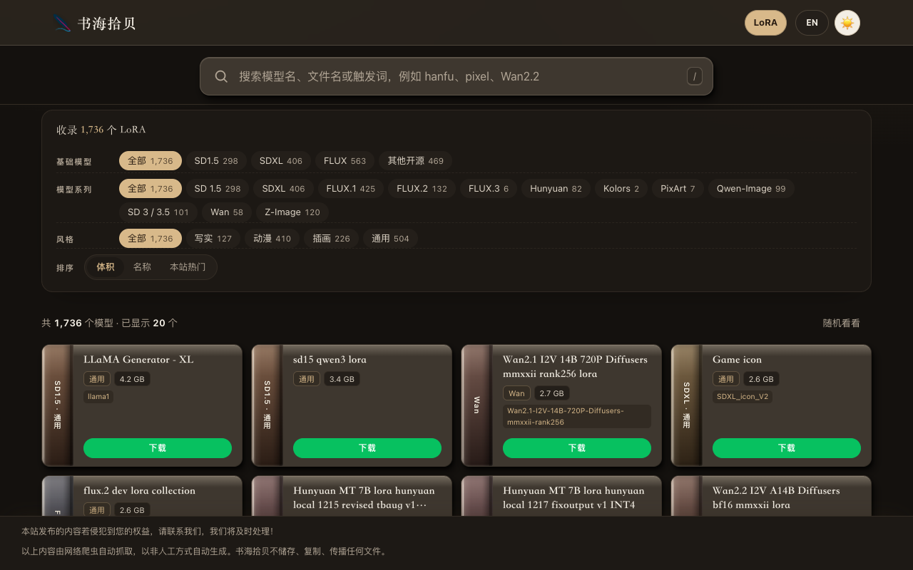

# LoRA 图鉴

欢迎来到《LoRA 图鉴》· 本地模型库，收录 1,736 个 LoRA。英文名是 LoRA Gallery。无论你是在找 SD1.5、SDXL、FLUX，还是其他开源系列的风格模型，这里都能查到。

https://www.embassygrade.com/lora/



## 打开

请用静态服务器打开。直接用 `file://` 时，搜索和筛选仍然可用，但点击统计不会请求接口。

```bash
python3 -m http.server 8811
```

然后打开 <http://127.0.0.1:8811/>。

`/api/lora-popular` 和 `/api/lora-clicks` 只在 http(s) 下请求。这两个接口不在本仓库里；请求失败时页面会安静跳过，继续显示 `data/lora.js` 里的本地目录。下载链接同样来自这份数据，不依赖额外后台。这里只有元数据，不包含模型文件。

许可证待定。
